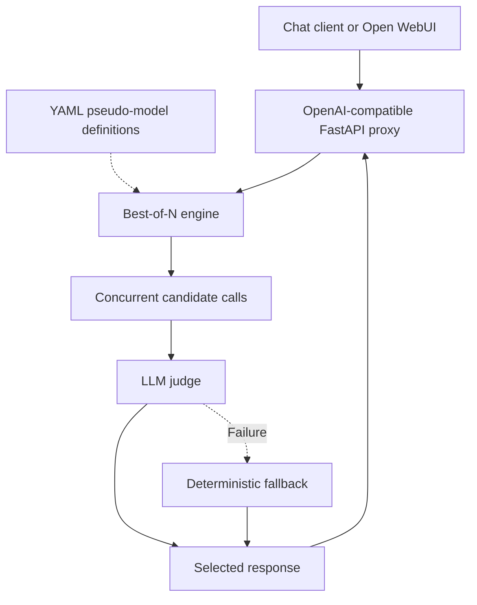

# Architecture

`config.py` validates provider references and candidate counts. Providers resolve their endpoint and credentials from YAML or environment variables. `provider.py` makes asynchronous HTTP requests, preserves the provider's `/v1` path, and retries failures.

`engine.py` expands fixed counts and proportional weights into N candidate calls. Explicit request seeds become sequential per-candidate seeds. Errors are collected so partial provider failure can still produce a reply. The judge receives nonempty candidates and returns an index. One valid candidate bypasses judging; invalid or failed judging selects a deterministic fallback. Requests with no nonempty response return HTTP 502.

`api.py` exposes health, strategy discovery, and chat completion routes. `cli.py` supplies the `bon serve` launcher with host, port, and configuration options. Configuration is read at startup.

The service does not persist conversations or generated responses. Candidate responses, errors, latency, and selection metadata exist in memory during processing. Deployed HTTP infrastructure and upstream providers may have their own logging or storage.

## API contract and selection behavior

- `GET /healthz` reports process availability only.
- `GET /v1/models` lists configured strategy IDs, sorted by name, as OpenAI-style model cards. It does not query or import upstream model tags.
- `POST /v1/chat/completions` resolves `request.model` to a strategy. Unknown strategy IDs return HTTP 404; all failed or blank candidate responses return HTTP 502.
- A single usable response bypasses judging. Multiple usable responses go to the judge, whose output must identify a valid candidate index. Failure, malformed JSON, or an invalid index triggers deterministic fallback.
- `stream: true` waits for selection, then sends the complete winning message in one SSE chunk followed by `[DONE]`. Candidate token streams are not forwarded.

Candidate HTTP calls run concurrently through `asyncio.gather`; the server has no global inference semaphore. Provider HTTP retries are distinct from judge-selection fallback. Candidate sampling overlays request parameters with strategy settings and then candidate settings. Judge sampling is separate.

The default judge rubric favors correctness, supported claims, and appropriate uncertainty. It permits clarification and appropriate refusals while discouraging fabricated details and unnecessary refusals. A custom `judge.prompt` replaces that default rubric.

The synthetic model ID is retained in the response, while returned token usage comes only from the winner's upstream response. It excludes other candidates and the judge. The fallback uses completion, nonempty-content, and bounded-length heuristics, with no phrase-based refusal penalty. It cannot assess factual correctness or determine whether a refusal is justified. The proxy is stateless across chat requests: clients such as WebUI supply conversation history in `messages`.

## Deployment boundaries

`docker-compose.yml` starts the proxy service named `bon-llm` and Open WebUI. Ollama runs separately. WebUI connects to `http://bon-llm:8000/v1`; the proxy reaches the configured provider, typically host Ollama through `host.docker.internal`. The WebUI volume persists its application state and conversations; the proxy has no result database.

For all configuration fields, pseudo-model examples, model downloads, network topologies, connection setup, and restart requirements, see [CONFIGURATION.md](CONFIGURATION.md).
