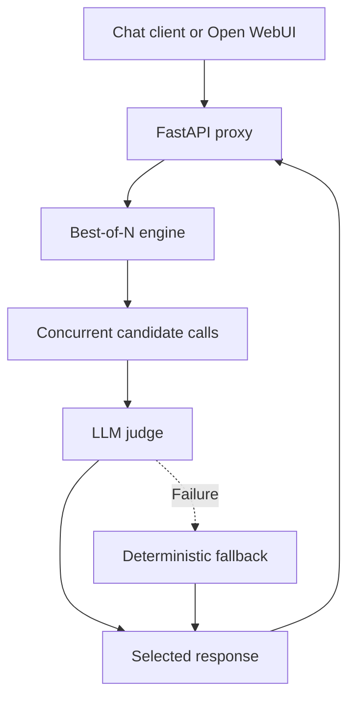

# Architecture

`config.py` validates provider references and candidate counts. Providers resolve their endpoint and credentials from YAML or environment variables. `provider.py` makes asynchronous HTTP requests, preserves the provider's `/v1` path, and retries failures.

`engine.py` expands fixed counts and proportional weights into N candidate calls. Explicit request seeds become sequential per-candidate seeds. Errors are collected so partial provider failure can still produce a reply. The judge receives nonempty candidates and returns an index. One valid candidate bypasses judging; invalid or failed judging selects a deterministic fallback. Requests with no nonempty response return HTTP 502.

`api.py` exposes health, strategy discovery, and chat completion routes. `cli.py` supplies the `bon serve` launcher with host, port, and configuration options. Configuration is read at startup.

The service does not persist conversations or generated responses. Candidate responses, errors, latency, and selection metadata exist in memory during processing. Deployed HTTP infrastructure and upstream providers may have their own logging or storage.
