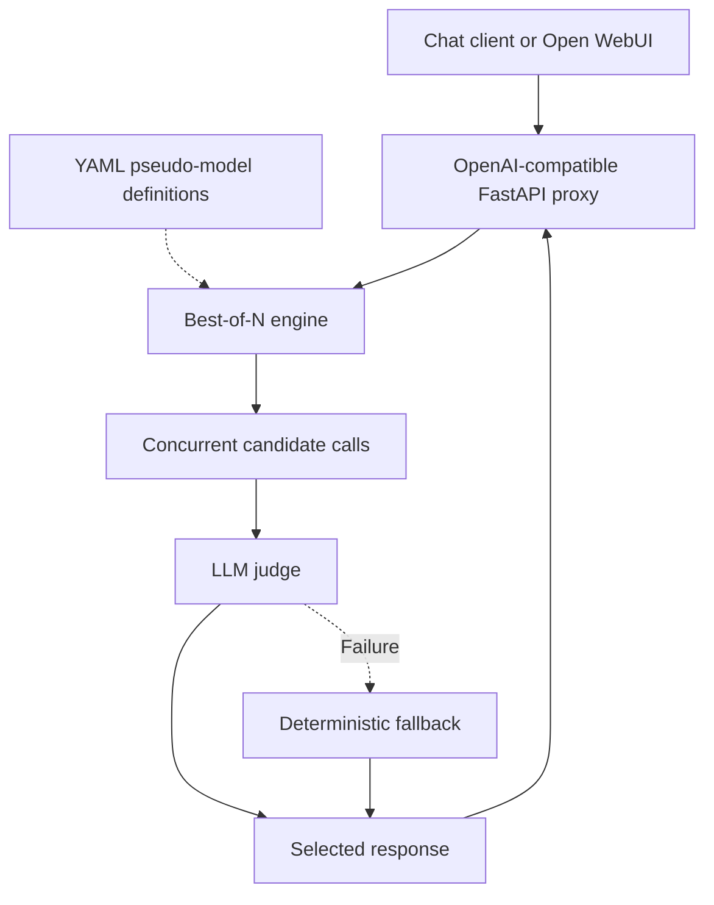

# Architecture

## Components

| Module | Responsibility |
| --- | --- |
| `config.py` | Load configuration; validate provider references and candidate counts. |
| `provider.py` | Resolve endpoints/credentials, preserve `/v1` paths, make asynchronous HTTP calls, and retry failures. |
| `engine.py` | Expand candidates, generate responses, judge, select fallback, and build the final response. |
| `api.py` | Health, model discovery, chat completions, and SSE responses. |
| `cli.py` | `bon serve` launcher with host, port, and configuration options. |

## Request flow

1. Resolve `request.model` to a YAML strategy and expand its fixed/weighted entries into N calls. Apply request, strategy, then candidate sampling settings. Explicit seeds become sequential per-candidate seeds.
2. Generate candidates concurrently through `asyncio.gather`. Provider failures are collected; successful candidates remain usable. There is no global inference semaphore.
3. A single nonempty candidate bypasses judging. Otherwise the judge receives usable candidates and returns an index. Provider HTTP retries are separate from selection fallback.
4. Failed judging, malformed JSON, or an invalid index triggers fallback based on completion, nonempty content, and bounded length. Refusal phrases receive no penalty. These heuristics establish neither correctness nor whether refusal is justified.
5. Return the winner under the requested pseudo-model ID. Token usage reflects only that candidate, excluding other candidates and the judge.

The default rubric favors supported claims and appropriate uncertainty, clarification, or refusal, while discouraging fabrication and unnecessary refusals. A custom `judge.prompt` replaces it.

## API contract

| Endpoint | Behavior |
| --- | --- |
| `GET /healthz` | Process availability; does not check upstream connectivity. |
| `GET /v1/models` | Configured strategy IDs, sorted by name, as OpenAI-style model cards. |
| `POST /v1/chat/completions` | Selected response; HTTP 404 for an unknown strategy, HTTP 502 when all candidates fail or are blank. |

`stream: true` waits for selection, then sends one SSE chunk containing the full winner followed by `[DONE]`. Candidate token streams are not forwarded. Discovery does not import raw upstream models.

## Persistence and deployment

The proxy is stateless across requests; clients supply history in `messages`. Candidates, errors, latency, and selection metadata remain in memory during processing. HTTP infrastructure and upstream providers may log or retain data independently.

Compose starts the proxy service `bon-llm` and Open WebUI; Ollama runs separately. WebUI's volume persists its settings and conversations. [Configuration](CONFIGURATION.md) covers startup/restarts, network addresses, provider fields, and setup steps.
