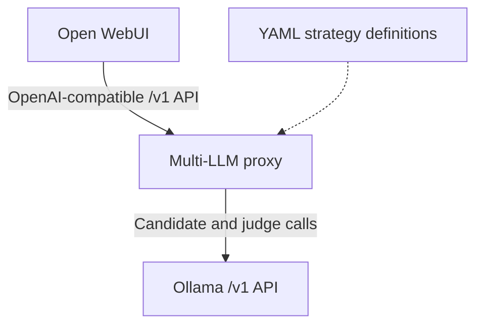

# Pseudo-model configuration and Open WebUI setup

## The three layers



A strategy name such as `bon/llama3.1` is a **pseudo-model ID**, not a model downloaded into Ollama or an Ollama Modelfile. The proxy publishes strategy IDs through `GET /v1/models`. When Open WebUI sends a chat completion using one of those IDs, the engine looks up its strategy, generates N candidates, asks the configured judge to select an answer, and returns the winner under the requested pseudo-model ID.

The proxy's provider layer calls Ollama's OpenAI-compatible API. It does not use Ollama's native `/api/chat` endpoint. Upstream behavior is documented in [Ollama's compatibility guide](https://docs.ollama.com/api/openai-compatibility).

## Configuration files and lifecycle

| File or setting | Role |
| --- | --- |
| `config/config.yaml` | Default provider and pseudo-model definitions. |
| `config/*.local.yaml` | Ignored location for private/operator-specific configuration. |
| `.env.example` | Optional exported-variable template; no real credentials. |
| `docker-compose.yml` | Proxy/WebUI ports, network addresses, environment forwarding, and WebUI persistence. |
| `bon serve --config <path>` | Selects a YAML file, resolving the path before starting the API. |
| `BON_CONFIG_PATH` | Selects a YAML file when no CLI `--config` is supplied. Defaults to `config/config.yaml` relative to the process working directory. |
| `OLLAMA_BASE_URL` | Overrides the example provider endpoint because its `base_url_env` names this variable. |

`--config` takes precedence over `BON_CONFIG_PATH`. YAML is read once at API startup; restart the proxy after edits. There is no live reload, automatic model pull, or implicit YAML environment-variable interpolation. Provider-specific `base_url_env` and `api_key_env` explicitly select environment variables.

The Python process does not automatically source `.env`. To use one in a host run:

```bash
cp .env.example .env
# Edit .env before exporting it.
set -a
source .env
set +a
bon serve
```

Compose reads `.env` for substitution. Its proxy service explicitly loads `/app/config/config.yaml` from the mounted `./config` directory; an unrelated host `BON_CONFIG_PATH` does not override that service setting. Additional provider keys must also be forwarded in the service environment, not merely written to `.env`.

## Providers

```yaml
providers:
  ollama:
    base_url: http://localhost:11434/v1
    base_url_env: OLLAMA_BASE_URL
    timeout_seconds: 120
    max_retries: 1
```

| Field | Meaning |
| --- | --- |
| `base_url` | Provider API base, including `/v1`; omit `/chat/completions`. |
| `base_url_env` | Optional environment variable whose nonempty value overrides the base URL. |
| `api_key_env` | Optional environment variable containing an upstream API credential. |
| `api_key` | Optional inline secret; prefer `api_key_env` in shareable configuration. An inline value takes precedence. |
| `timeout_seconds` | Provider HTTP timeout, default 120 seconds; also applies to its judge calls. |
| `max_retries` | Number of retries after the first attempt, default 2. The sample Ollama provider uses 1. |

Use matching provider names in candidates and judges. The loader validates these references. A model name is sent to the provider as configured; startup does not check that the model exists. The HTTP client retries HTTP errors and invalid JSON responses with exponential backoff. An invalid judge selection itself triggers fallback rather than another judge-generation loop.

Credentials presented by Open WebUI to the local proxy are separate from upstream provider credentials. The proxy does not authenticate incoming API keys. Its placeholder key is not an Ollama credential.

## Pseudo-models and model pools

The shipped configuration defines:

| Pseudo-model ID | Candidate calls | Judge |
| --- | --- | --- |
| `bon/llama3.1` | Three calls to `llama3.1:8b`. | `qwen2.5:14b` |
| `bon-pool/general` | One call each to `llama3.1:8b`, `qwen2.5:7b`, and `mistral:7b`. | `qwen2.5:14b` |

Pull the relevant models on the **Ollama server**, not into the proxy image:

```bash
ollama pull llama3.1:8b
ollama pull qwen2.5:14b
# Also needed for bon-pool/general:
ollama pull qwen2.5:7b
ollama pull mistral:7b
```

A complete strategy definition looks like:

```yaml
strategies:
  bon/custom:
    n: 3
    candidates:
      - provider: ollama
        model: llama3.1:8b
        weight: 1
    judge:
      provider: ollama
      model: qwen2.5:14b
      sampling:
        temperature: 0
    sampling:
      temperature: 0.7
      top_p: 0.95
      max_tokens: 512
```

| Field | Meaning |
| --- | --- |
| Strategy dictionary key | Client-visible ID returned by `/v1/models`; use exactly this ID in chat requests. |
| `n` | Positive total candidate count, default 3. |
| `candidates` | Nonempty list of upstream provider/model pairs. |
| Candidate `count` | Positive fixed number of slots reserved for that entry. |
| Candidate `weight` | Positive proportional weight for remaining slots when `count` is absent; defaults effectively to 1. |
| Candidate `sampling` | Per-candidate temperature, top-p, and max-token overrides. |
| Strategy `sampling` | Sampling settings applied to all candidates before candidate-specific overrides. |
| `judge.provider`, `judge.model` | Required judge configuration; judge sampling defaults to temperature 0. |
| `judge.prompt` | Optional replacement rubric, combined with the conversation and candidate responses. |
| `judge.sampling` | Judge temperature, top-p, and max-token settings. |

Fixed counts are allocated first. Remaining slots are split by normalized weights, rounded down, then assigned by largest fractional remainders. For example, `n: 5` with one fixed slot plus weights 3 and 1 produces 1 fixed, 3 heavy, and 1 light candidate. Give an entry either `count` or `weight`; a supplied `count` makes its weight irrelevant. Counts exceeding N, or fixed-only lists that fail to fill N, are rejected during configuration validation.

Candidate sampling precedence is **request values → strategy sampling → candidate sampling**; later values win. Incoming `max_completion_tokens` is normalized to `max_tokens` before these overrides are applied. Explicit request seeds become `seed + candidate index`; otherwise each candidate gets a random seed. Judge sampling is configured separately. The supported sampling fields are `temperature`, `top_p`, and `max_tokens`; timeouts belong to providers.

Only configured strategies appear in discovery. Raw upstream model IDs are not automatically passed through. For a single-call strategy, use `n: 1` and one candidate; a judge definition is still required by configuration, but selection skips judging when only one usable response exists.

## Connect Open WebUI

Use an **OpenAI-compatible connection** to this proxy. Adding it as a native Ollama connection uses the wrong protocol. In Open WebUI, open **Settings → Admin → Connections → Manage OpenAI API Connections**, add the base URL appropriate to the deployment below, use a placeholder key if required, verify, and save. Then select `bon/llama3.1` or `bon-pool/general` from the model picker. See the upstream [connection guide](https://docs.openwebui.com/getting-started/quick-start/connect-a-provider/starting-with-openai-compatible/).

| Deployment | Open WebUI's proxy base URL | Required binding/network |
| --- | --- | --- |
| WebUI and proxy processes both on host | `http://127.0.0.1:8000/v1` | Default `bon serve` loopback binding. |
| Supplied Compose stack | `http://bon-llm:8000/v1` | Compose service DNS; proxy listens on the container interface. |
| WebUI in Docker, proxy on host | `http://host.docker.internal:8000/v1` | Start proxy with `bon serve --host 0.0.0.0`; on Linux add host-gateway mapping to WebUI. Restrict host access. |
| WebUI on another machine | `http://<proxy-host>:8000/v1` | A reachable proxy interface or private reverse proxy/tunnel. The proxy has no inbound authentication. |

The URL is resolved by the **Open WebUI backend**, not by the browser. `localhost` inside its container refers to that container. A host service bound only to `127.0.0.1` is not reachable through a Docker bridge just by changing the hostname.

The Compose stack initializes WebUI with the proxy's OpenAI connection and disables its direct Ollama integration. A separately configured direct Ollama connection bypasses this project's candidate selection. WebUI persists connection settings in its data volume, so existing installations may require updating/disabling connections through the admin UI even after Compose environment variables change. Do not delete the volume just to refresh a connection. See [Open WebUI's environment reference](https://docs.openwebui.com/reference/env-configuration/).

## Docker-to-Ollama networking

The supplied Compose stack contains the proxy and Open WebUI; it does not start Ollama. The default proxy-container endpoint is `http://host.docker.internal:11434/v1`, with Linux `host-gateway` mapping.

Host Ollama must accept connections on a Docker-reachable interface. For a manual server, an example is `OLLAMA_HOST=0.0.0.0:11434 ollama serve`, with firewall access restricted to the intended clients. An already-running desktop app or service needs its own environment configuration and restart; do not start a second conflicting server. See [Ollama's server configuration guidance](https://docs.ollama.com/faq#how-do-i-configure-ollama-server).

For another machine or container, set `OLLAMA_BASE_URL` to that reachable provider URL including `/v1`. The host port bindings `127.0.0.1:8000` and `127.0.0.1:3000` control browser/host access; containers on the Compose network use their service ports directly.

```bash
docker compose up --build
# After YAML configuration edits:
docker compose restart bon-llm
# After Compose environment edits:
docker compose up -d
# Stop services while preserving WebUI data:
docker compose down
```

Open WebUI's `open-webui` volume contains its own application data and conversations. The proxy itself does not persist chat responses. Preserve that volume deliberately; `docker compose down -v` would remove it.

## Verify and troubleshoot

Check the upstream and downstream separately:

```bash
# Host Ollama defaults; adapt to your chosen endpoint:
curl -fsS http://localhost:11434/v1/models
# Proxy health and pseudo-model discovery:
curl -fsS http://localhost:8000/healthz
curl -fsS http://localhost:8000/v1/models
curl -fsS http://localhost:8000/v1/chat/completions \
  -H 'Content-Type: application/json' \
  -d '{"model":"bon/llama3.1","messages":[{"role":"user","content":"Say hello in one sentence."}]}'
```

`/healthz` proves that the API is running, not that Ollama is reachable. A successful discovery call proves configuration loaded; the completion call checks actual candidate/judge inference.

| Symptom | Check |
| --- | --- |
| WebUI shows raw Ollama models only | Add/enable the proxy's OpenAI connection and select a configured pseudo-model. |
| Model list request fails | Include `/v1`, omit `/chat/completions` from the connection base, and test from the WebUI backend's network. |
| HTTP 404 for chat model | Use a strategy ID, not the underlying provider's model tag. |
| HTTP 502 / no usable candidates | Verify provider URL, installed models, credentials, reachability, and provider timeouts. |
| Slow first reply or timeout | Candidates and judge may need model loading; choose models/counts fitting available memory and increase the provider timeout if appropriate. |
| No tokens appear immediately | Streaming waits for candidate generation and selection, then sends the completed winner. |
| YAML edits do not show up | Restart the proxy; the public edition has no live reload. |
| Saved WebUI connection ignores Compose edits | Update its persisted admin connection rather than removing conversation data. |

[ARCHITECTURE.md](ARCHITECTURE.md) maps these behaviors to the code. This is a chat-selection proxy; it does not expose model download/delete endpoints, embeddings, tool execution, or the Responses API.
